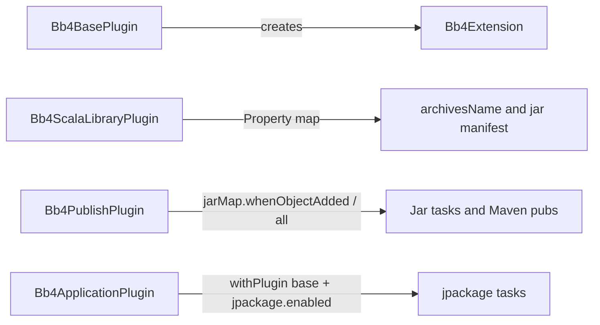

# Kotlin rewrite of bb4 convention plugins (#44)

> **For agentic workers:** Use superpowers:subagent-driven-development or executing-plans. Save a copy under `docs/superpowers/plans/2026-11-12-kotlin-plugin-rewrite.md` when implementing.

**Goal:** Rewrite plugin implementation in Kotlin with a typed, lazy `bb4 {}` DSL owned by `bb4.base`, remove `afterEvaluate`, and keep Groovy `build.gradle` consumers green.

**Architecture:** Add Kotlin JVM to the existing `java-gradle-plugin` project; move `src/main/groovy` → `src/main/kotlin` (same package). Create `Bb4Extension` in `Bb4BasePlugin`. Replace deferred `afterEvaluate` configuration with Property mapping and a jarMap container that still accepts Groovy `put(key, [include:…])`. Leave full `bb4.apps { register… }` task generation to [#38](https://github.com/bb4/bb4-gradle/issues/38) and jarMap structural redesign to [#42](https://github.com/bb4/bb4-gradle/issues/42).

**Tech stack:** Gradle 9.1+, Java 25, Kotlin JVM (version aligned with Gradle’s embedded Kotlin), existing Spock/TestKit Groovy tests.

## Global constraints

- No intentional behavior change for Groovy consumers (`build.gradle` stays valid).
- Plugin IDs and implementation class FQCNs stay the same.
- Preserve legacy `ext.jarMap` and `ext.appMap` fallbacks (with current conflict rules).
- Keep jarMap POM `withXml` dependency injection behavior (issue-15); only relocate into Kotlin helpers.
- Out of scope: #38 apps DSL/task generation, #42 jarMap delete/subprojects/`dependOn`, #40/#41/#43 quality/layout work.

## File map

**Create (Kotlin ports of today’s 19 Groovy files under** [`src/main/groovy/com/barrybecker4/gradle/plugins/`](src/main/groovy/com/barrybecker4/gradle/plugins/)**):**

- `src/main/kotlin/com/barrybecker4/gradle/plugins/Bb4Extension.kt` — plus nested `Bb4JpackageExtension`, `JarMapEntry`, optional app-map type
- `Bb4BasePlugin.kt`, `Bb4ScalaLibraryPlugin.kt`, `Bb4PublishPlugin.kt`, `Bb4ApplicationPlugin.kt`, `Bb4SettingsPlugin.kt`
- Support: `Bb4Conventions`, `Bb4JarMap`, `Bb4PomSupport`, `Bb4JpackageSupport`, `Bb4CatalogToml`, `Bb4DependencyVersions`, `Bb4SigningSupport`, `Bb4SnapshotRepoSupport`, `Bb4CentralBundleSupport`, `Bb4CentralPortalClient`, `Bb4CycloneDxSupport`, `Bb4SiblingBuilds`

**Modify:**

- [`build.gradle.kts`](build.gradle.kts) — add `org.jetbrains.kotlin.jvm`; keep `groovy` for tests; drop main Groovy compilation once ported
- [`README.md`](README.md) — document `bb4 {}` on base; `repository`; Java-only + publish example
- [`CHANGELOG.md`](CHANGELOG.md) — note Kotlin rewrite + extension ownership move
- [`docs/migration-from-scripts.md`](docs/migration-from-scripts.md) — only if consumer-facing snippets need `repository` / base ownership

**Delete after green tests:** all of `src/main/groovy/**`.

**Tests (must stay green; add one):** existing TestKit/Spock suites under `src/test` and `src/functionalTest`, plus new base+java+publish coverage for `archivesBaseName` / `repository`.

## Target public API

```kotlin
abstract class Bb4Extension @Inject constructor(objects: ObjectFactory) {
  abstract val archivesBaseName: Property<String>   // convention ""; empty → project.name
  abstract val mainClass: Property<String>
  abstract val scalaVersion: Property<String>       // catalog default
  abstract val repository: Property<String>         // NEW; prefer over findProperty("bb4.repository")
  val jarMap: NamedDomainObjectContainer<JarMapEntry>
  abstract val appMap: MapProperty<String, Map<String, Any?>>  // NEW; legacy ext.appMap fallback
  val jpackage: Bb4JpackageExtension
}

abstract class JarMapEntry : Named {
  abstract val include: ListProperty<String>
  abstract val exclude: ListProperty<String>
}
```

Groovy compatibility for jarMap: keep `jarMap.put('common', [include: ['…'], exclude: ['…']])` via a container/`ExtraProperties`-style `put` that creates/configures a `JarMapEntry` from the map (so `whenObjectAdded` fires during the consumer’s `bb4 {}` block without `afterEvaluate`). Typed form also works: `jarMap.create('common') { include.add('…') }`.

`repository` resolution order in `Bb4PomSupport`: extension `repository` if present → else `findProperty("bb4.repository")` → else `project.name`.

`appMap` resolution: extension map if non-empty → else `ext.appMap` / `findProperty('appMap')` (same conflict style as jarMap only if both non-empty and you choose to enforce it; default = prefer extension, else legacy, no dual-config throw unless tests require parity with jarMap).

## afterEvaluate replacements



1. **Scala library** ([`Bb4ScalaLibraryPlugin.groovy`](src/main/groovy/com/barrybecker4/gradle/plugins/Bb4ScalaLibraryPlugin.groovy) L62–80): stop creating extension; map `archivesBaseName` → `BasePluginExtension.archivesName` and jar `archiveFileName` / `Main-Class` with Providers (`orElse(project.name)` when empty). No `afterEvaluate`.
2. **Publish** ([`Bb4PublishPlugin.groovy`](src/main/groovy/com/barrybecker4/gradle/plugins/Bb4PublishPlugin.groovy) L81+): on `jarMap.all` / `whenObjectAdded`, register `${key}Jar` + publication; if any entries exist (or when first added), disable default jar/sources/javadoc(/scaladoc) jars; single-jar path registers the current `components.java` publication when container is empty at end of configuration using a **single** deferred hook only if container emptiness cannot be known earlier—prefer: register default publication eagerly, and when first jarMap entry is added disable it and switch to multi-jar mode (matches today’s “empty → single, non-empty → multi”). Signing / Central bundle configure against the publishing extension without waiting for project evaluation where credentials are already `Provider`-backed.
3. **Application** ([`Bb4ApplicationPlugin.groovy`](src/main/groovy/com/barrybecker4/gradle/plugins/Bb4ApplicationPlugin.groovy) L44–49): `withPlugin('com.barrybecker4.bb4.base')` (not only scala-library) to wire `application.mainClass` ← `bb4.mainClass`. Register jpackage tasks lazily from `jpackage.enabled` / appMap providers (e.g. realize when enabled is true during configuration after `bb4 {}`, or register skeleton tasks with `onlyIf` + input validation)—no `afterEvaluate`.

## Implementation tasks

### Task 1: Kotlin build scaffolding

- Add `org.jetbrains.kotlin.jvm` to [`build.gradle.kts`](build.gradle.kts); keep `groovy` + Spock for tests.
- Ensure `src/main/kotlin` compiles into the same plugin jar; `implementation(gradleKotlinDsl())` only if needed for Kotlin DSL types—prefer plain Gradle API.
- Verify `./gradlew classes` still builds current Groovy sources (side-by-side briefly is OK).

### Task 2: Extension + base ownership (TDD)

- Add failing TestKit case: `bb4.base` + `java-library` + `bb4.publish` with
  ```groovy
  bb4 {
    archivesBaseName = 'plain-java'
    repository = 'bb4-example'
  }
  ```
  Assert POM / artifact naming uses those values (and that `bb4 {}` resolves with only base applied).
- Implement Kotlin `Bb4Extension` / `JarMapEntry` / `Bb4JpackageExtension`; create extension in `Bb4BasePlugin`; remove `extensions.create` from scala-library.
- Wire `repository` through `Bb4PomSupport`.
- Promote `appMap` onto the extension with legacy fallback for deployHtml/jpackage.

### Task 3: Port pure support classes

- Port `Bb4CatalogToml`, `Bb4DependencyVersions`, `Bb4SiblingBuilds`, `Bb4SnapshotRepoSupport`, `Bb4JpackageSupport`, `Bb4SigningSupport`, `Bb4CentralPortalClient`, `Bb4CentralBundleSupport`, `Bb4CycloneDxSupport`, `Bb4Conventions`, `Bb4JarMap`, `Bb4PomSupport` to Kotlin.
- Keep unit tests (`Bb4CatalogTomlTest`, `Bb4CentralPortalClientTest`, `Bb4JpackageSupportTest`, `Bb4SiblingBuildsTest`) passing—adjust only for Kotlin `@JvmStatic` / package visibility if required.

### Task 4: Port plugins and remove afterEvaluate

- Port five plugins; apply the lazy wiring described above.
- `Bb4JarMap.resolve` returns typed entries (from container + legacy `ext.jarMap`).
- Preserve Groovy Closure dispatch for jpackage `mainJarKey` / `javaOptions` / `arguments` (current `invokeConfigured` behavior).
- Delete `src/main/groovy` when Kotlin ports compile and replace them.

### Task 5: Docs + verification

- Update README composition table: `bb4.base` creates `bb4 {}`; document `repository`; note Java-only publish can set archives/repo on the extension.
- CHANGELOG entry for #44.
- Run `./gradlew check` (unit + functionalTest).
- Spot-check `config-cache-test` with `--configuration-cache` for clean/doc/deploy paths already covered there.

## Acceptance checklist

- All existing tests green; new base+java+publish extension test green.
- Zero `afterEvaluate` in `src/main/kotlin` plugin code.
- `bb4 {}` available from `bb4.base` alone.
- Groovy samples using `jarMap.put`, `ext.appMap`, and `bb4.repository` / new `bb4.repository` property still work.
- Plugin IDs unchanged; published artifact still consumes as today.